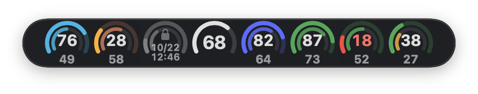
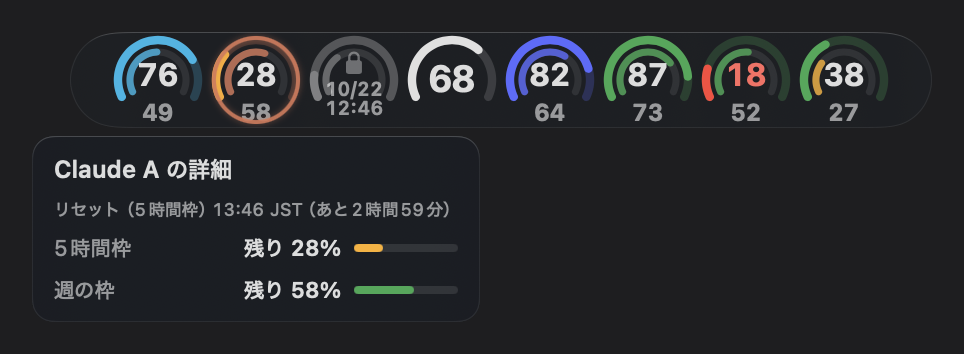
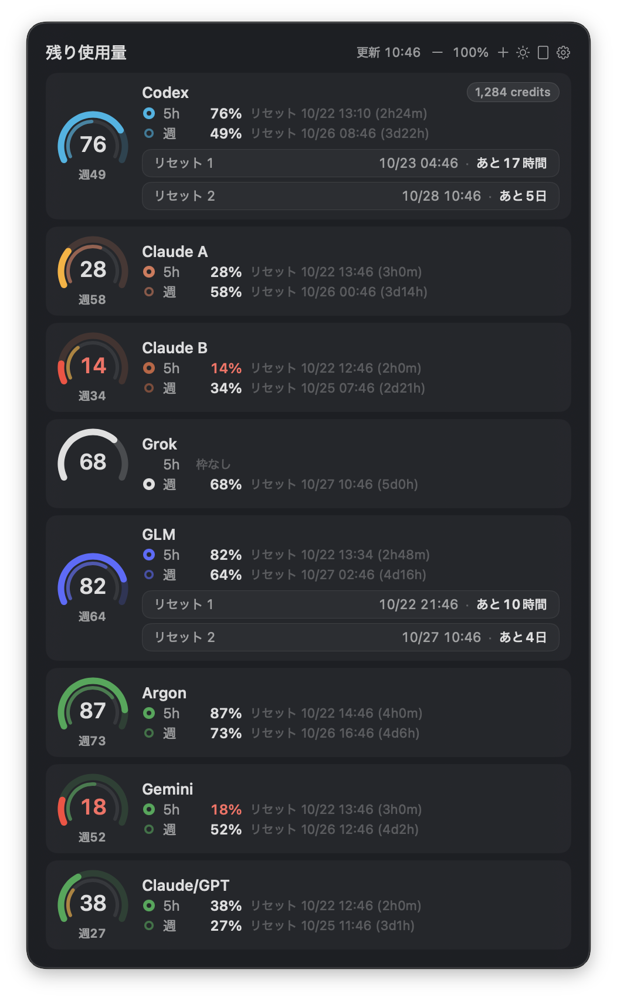
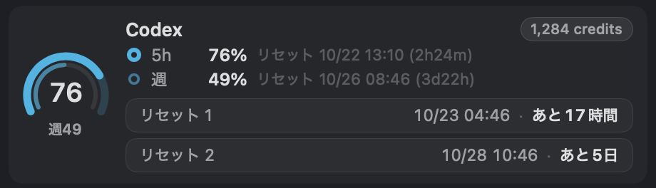

# UsageRings

AIサービスの使用枠とリセット時刻を、画面に浮かぶ小さなリングでひと目で確認できるmacOSアプリです。

[English](README.md) · [ビルドとインストール](#ビルドとインストール) · [トラブルシューティング](#トラブルシューティング)



## できること

- 残り使用量をリングで常時確認し、ホバーや詳細パネルで内訳を見る。
- 取得元が返す5時間枠・週の枠、リセットまでの時間、週の消費ペースを比較する。月単位など、ほかの報告された使用枠にも対応。
- 取得できる場合は、リセットチケット、残高、制限通知、取得エラーもまとめて確認する。
- 横・縦の配置、パネルとバーの拡大率、明暗テーマ、透明度、表示するサービスとアカウントを選ぶ。
- アカウントにラベルを付け、**Primary**で縮小リングに出すアカウントを絞る。他の表示中アカウントはパネルに残る。

全体は約1分ごとに更新しますが、各取得処理には個別のキャッシュ・待機時間があります。不明な値は未使用枠を意味しません。保持した過去の値には前回値・staleの表示が付きます。UIの一部は日本語です。

## 対応プロバイダー

値はプラン、ログイン状態、インストール済みの取得ツールの応答に依存します。すべてのアカウントで全使用枠が得られるという保証ではありません。

<!-- provider-table:start -->
| プロバイダー | 表示するもの | 取得方法・必要な設定 |
| --- | --- | --- |
| Codex | セッション・5時間枠と週の枠。報告されたクレジット・リセットチケット | CodexBarCLI。CodexBarでCodexを設定 |
| Claude Code | 設定したログインごとの5時間枠・週の枠、リセットチケット、独立したログの制限通知 | CodexBarCLIの `--source cli`。Claude Codeでログイン済みであること。チケット取得元は後述 |
| Grok | 報告された使用枠と詳細 | CodexBarCLIの `--source cli`。ローカルのGrok CLIでログインを設定 |
| GLM Coding Plan | 報告された使用枠、Z.aiのリセットチケット詳細 | CodexBarCLI（`zai`）。CodexBarでZ.aiを設定。チケットはZ.ai APIも使用 |
| MiniMax | 報告された使用枠と詳細 | CodexBarCLI。CodexBarでMiniMaxを設定 |
| Kimi | 報告された使用枠と詳細 | CodexBarCLI。CodexBarでKimiを設定 |
| DeepSeek | 残高と使用実績。上限割合のリングは表示しない | CodexBarCLI。CodexBarでDeepSeekを設定 |
| OpenDesign | Design Planの5時間枠・7日枠 | OpenDesignのcontrol APIへ直接接続。公式アプリまたは `od amr login` でログイン |
| Antigravity | 報告されたモデルグループ別の使用枠 | CodexBarCLIの `--source cli`。ローカルのAntigravity CLIでログインを設定 |
| Gemini | 読み取り可能なGeminiアプリの5時間枠・週の値 | 任意の[Chrome自動操作](Sources/CodexUsageWidget/Services/GeminiAppUsage.swift)で `gemini.google.com/usage` を読む。初期状態はオフ。Antigravityとは別 |
<!-- provider-table:end -->

OpenDesignとGemini以外にはCodexBarCLIが必要です。参照先は `/Applications/CodexBar.app/Contents/Helpers/CodexBarCLI` 固定で、`PATH`の検索やパス変更設定はありません。CodexBarのメニューバーアプリを起動し続ける必要はありません。UsageRingsは各社CLIのインストールやログインを行いません。Claude・Grok・Antigravityは明示的にCLI取得元を使い、それ以外のCodexBar経由のサービスはCodexBarの取得元選択に従います。

実装の参照先: [プロバイダー一覧](Sources/CodexUsageWidget/Models/MultiUsageSnapshot.swift)、[取得・取得元の方針](Sources/CodexUsageWidget/Services/MultiUsageService.swift)、[使用枠の解析](Sources/CodexUsageWidget/Services/MultiProviderParser.swift)。

## ビルドとインストール

**macOS 14以降**と**Swift 5.9以降**が必要です。`xcode-select`でXcodeまたはCommand Line Toolsを選択してください。固定バージョンのSparkleを取得するインターネット接続も必要です。[Package.swift](Package.swift)を参照してください。

このリポジトリをダウンロードまたはcloneして実行します。

```sh
cd usagerings
swift build
swift test --filter READMEProviderTests
USAGERINGS_SIGN_IDENTITY=- ./script/build_and_run.sh usagerings package
./script/build_and_run.sh usagerings package-verify
```

すでにソースのディレクトリにいる場合は `cd usagerings` を省略します。[パッケージ作成スクリプト](script/build_and_run.sh)が `dist/UsageRings.app` を作り、`package-verify`がバンドルを検査します。明示した `-` はローカルのad-hoc署名を選び、署名IDや開発者アカウントは不要です。この手順はインストール・起動・公証・公開を行いません。できたアプリをApplicationsにドラッグし、自分で開いてください。再ビルド後はKeychainへのアクセス許可を再び求められる場合があります。

`usagerings package`を明示してください。モードを省略すると従来の `run` 動作になり、実行中のアプリを停止し、`~/Applications/UsageRings.app` を置き換えて起動します。SwiftPMの実行ファイル名は引き続き `CodexUsageWidget` です。生の `swift run` は複数プロバイダー版のインストール手順ではありません。

## 初回設定

1. [CodexBar](https://github.com/steipete/CodexBar)を `/Applications` に入れ、使うサービスを設定します。ヘルパー不足の案内では、インストール後に **もう一度確認**、または **あとで** を選んで続けます。
2. リングの詳細パネルから **歯車（Settings）** を開き、**表示するサービス**を選びます。初期状態では使用量を取得できたサービスが自動でオンになります。明示的にオフにしたサービスは取得しません。未選択サービスの再確認は最短30分間隔です。
3. **アカウント**でラベル・表示・**Primary**を設定します。アカウント名は初期状態で非表示で、名前の表示をオンにすると伏せ字になります。カスタムラベルは入力した内容が表示されます。Antigravityは初期状態ではモデルごとにまとめ、**Antigravityをアカウント別に表示**で分けられます。
4. Geminiを使う場合はChromeを起動し、自分でGeminiにログインします。アプリのメニューで **Gemini の使用量を読む** をオンにし、macOSのオートメーション許可とChromeの **Apple Events からの JavaScript を許可** を有効にします。UsageRingsは専用の非表示ウィンドウを作成・再読み込みできます。既存の使用量タブも、そのタブを再読み込みせず読めます。読み取りをオフにすると専用ウィンドウを閉じます。ログインや本人確認の代行はしません。

### Claudeアカウントとリセットチケット

既存の `~/.claude-a`・`~/.claude-b` ディレクトリからログインを自動検出し、どちらもなければ通常の `~/.claude` を使います。**Settings → Claude accounts**で1行に `ラベル = フォルダ` を入力すると別の設定ディレクトリを選べ、自動検出にも戻せます。各ログインは個別の `CLAUDE_CONFIG_DIR` でCodexBarCLIへ順番に問い合わせるため、バックグラウンド取得の完了後に値が現れる場合があります。

**Claudeの使う順番を自動で決める（claude-ab）**は初期状態でオンです。A/B両方のIDを曖昧さなく照合できた場合、既存の `claude-ab` ラッパー向けにローカルの期限付きヒントを書きます。週のリセットが早い方を優先し、制限中は一時的に他方を選びます。ラッパーのインストールや実行中セッションの切替は行いません。[選択方針とヒント形式](docs/claude-account-switching.md)を参照してください。

Claudeのチケットは、読み取り専用のOAuth使用量応答と、同じ組織の [Claude Desktop使用量キャッシュ](Sources/CodexUsageWidget/Services/ClaudeDesktopResetCache.swift)を組み合わせます。キャッシュを更新するには **Claude Desktop → Settings → Usage** を開いてください。キャッシュ由来のチケットには観測時刻が付きます。OAuthのチケット確認はアカウントごとに最短15分間隔で、レート制限による長い待機時間も尊重します。取得不能・対象外の応答を0枚とは扱いません。GLMのチケット詳細は標準CodexBar設定のglobalリージョンのZ.aiキーを使い、独自APIホスト・設定パスの上書き・複数トークンアカウントには対応しません。UsageRingsはチケットを表示し、使用する操作は行いません。

### 任意のリモートClaude通知

Settingsの **Read remote Claude B limits over SSH** は初期状態ではオフで、接続先も空です。Bash・GNUツール・Python 3を備えたLinuxホストの `~/.claude-b/projects` から制限イベントを最短5分間隔で読みます。SSH認証とホスト鍵の信頼設定は事前に済ませてください。ホスト名・SSHの別名・`user@hostname`を指定でき、独自ポートやオプションには別名を使います。変更は次の更新で反映します。ログのプロファイルだけでは使用枠アカウントの同一性を確認できないため、**Claude logs A/B**通知はアカウントのリングやPrimary設定から独立しています。

## プライバシーとセキュリティ

既存のローカルログイン・設定を利用します。最新の使用量取得では各サービスへの通信が発生します。UsageRings独自のクラウドアカウントやアクセス解析サービスはありません。

| ローカルで読むもの | Macの外へ出るもの |
| --- | --- |
| CodexBarCLIと設定済みのサービスログイン | CodexBarCLIが各サービスへ送る要求。その取得での認証・取得元の扱いはCodexBarに依存 |
| `~/.config/codexbar/config.json` または `~/.codexbar/config.json` のZ.aiキー | キーで認証したZ.aiリセットチケットAPIへの要求 |
| OpenDesign AMRの `prod` controlKey。通常は `~/.amr/config.json`（`AMR_HOME`にも対応） | キーで認証した `amr-api.open-design.ai` への使用量要求 |
| Keychainの既存Claude Code OAuthログイン | トークンで認証したAnthropicの固定使用量APIへのチケット確認GET |
| Claudeログインの組織IDと `~/Library/Application Support/Claude/Cache/Cache_Data` 内の該当する限られたエントリ | Desktopキャッシュ読み取りは送信なし。Cookieや通信を使わずキャッシュ済み使用量応答を読む |
| `~/.claude/projects`・`~/.claude-a/projects`・`~/.claude-b/projects` の最近のログ末尾（量を制限）、A/B照合用のプロフィールのメール情報 | ローカル監視はログを送らない。任意のSSHでは指定ホストへ接続し、制限文面・時刻・モデル識別子に絞った情報を受信 |
| 有効にした場合のみChrome自動操作で読むGemini使用量ページのテキスト | Chromeがログイン済みセッションで使用量ページを読み込み・再読み込みする。UsageRingsはブラウザーのCookieやパスワードを取り出さない |

直接接続する [Claudeチケット](Sources/CodexUsageWidget/Services/ClaudeResetGrants.swift)・[Z.ai](Sources/CodexUsageWidget/Services/ZaiResetTickets.swift)・[OpenDesign](Sources/CodexUsageWidget/Services/OpenDesignUsage.swift)クライアントではCookieとリダイレクトを無効にしています。UsageRingsは既存の認証情報を読みますが、新しい認証情報をKeychainへ保存しません。

設定とGeminiの前回値はローカルのUserDefaultsに保存します。アカウント表示設定の識別子には生のID・メールではなく、salt付きのプロバイダー別ハッシュを使います。カスタムラベルとClaude設定パスはローカル設定です。Codexスナップショットと機微情報を伏せた取得失敗ログは `~/Library/Application Support/CodexUsageWidget-Multi/` に保存します。一時スナップショットと使用枠診断は `$TMPDIR` 内のユーザー専用 `UsageRings` フォルダを使います（ディレクトリ0700、スナップショット0600）。読めなかったGeminiページの伏せ字サンプルを `~/Library/Application Support/UsageRings/` に保存する場合もあります。診断情報・ラベル・スクリーンショットは個人の使用情報として扱い、共有前に確認してください。

任意のiPhone向けiCloud同期は初期状態でオフです。送信処理は、対応する使用率・リセット時刻・取得状態・時刻情報とランダムな端末・アカウントIDを、本人のCloudKit private databaseへ送れます。認証情報・名前・ログ・残高は含みません。**このソースのパッケージ作成手順には必要なiCloud entitlement・container設定が含まれない**ため、この手順だけで同期は使えません。[送信処理とentitlement確認](Sources/CodexUsageWidget/Services/CloudSnapshotSender.swift)を参照してください。

## トラブルシューティング

| 症状 | 確認すること |
| --- | --- |
| CodexBarCLIがない | CodexBarをサブフォルダではなく `/Applications` 直下へ入れ、前述の固定パスを確認する。OpenDesign・Geminiの取得は別だが、起動時の案内はCodexBarを確認する |
| サービスが出ない | ログイン設定後、**表示するサービス**でオンにする。自動確認はすぐには再実行されない場合がある |
| ログインエラー・値がない | CodexBarまたは対象CLIで確認する。Claudeは **Claude accounts** のパスと、順番に進むバックグラウンド取得の完了を確認する |
| 前回値・stale表示、リセット不明 | エラーと観測時刻を確認し、ログイン・通信の問題を解決後に更新する。欠損は全量残っている意味ではない |
| Claudeチケットが未確認 | 対象アカウントのDesktop **Settings → Usage** を開き、キャッシュ時刻を確認する。API対象外や429では不明のままになる場合がある |
| Geminiが不明・停止中 | Chromeを起動し、オートメーションとJavaScriptの許可を確認する。ログイン・本人確認はChromeで自分で解決後、読み取りをオフ→オンにする。専用ウィンドウがなければ **作り直す** を使う。取得は最短5分間隔で、未操作・スリープ・現地時刻01:00〜05:59は休止する |
| OpenDesignが取得できない | OpenDesign/AMRでログインし、個人用ワークスペースに有効なDesign Planがあるか確認する |
| SSH通知が失敗する | アプリ外で別名・信頼済みホスト鍵を確認し、リモートのツールとログパスを調べる。パネルのエラーには接続先を含めない |
| ビルドに失敗する | `swift --version`・`xcode-select -p` と依存取得の通信を確認する。リポジトリの規約チェックは `./script/lint.sh` |

## その他のスクリーンショット

すべて内蔵のデモデータで、実アカウントの値ではありません。

| ホバーの詳細 | 詳細パネル |
| --- | --- |
|  |  |



## 開発への参加とライセンス

開発・検証は [CONTRIBUTING.md](CONTRIBUTING.md)、脆弱性の報告は [SECURITY.md](SECURITY.md)、参加時の方針は [行動規範](CODE_OF_CONDUCT.md)をご覧ください。役立ったらGitHubのStarで見つけやすくしていただけるとうれしいです。

[MIT License](LICENSE)、著作権者はAkiGarageです。外部依存ライブラリにはそれぞれのライセンスが適用されます。
