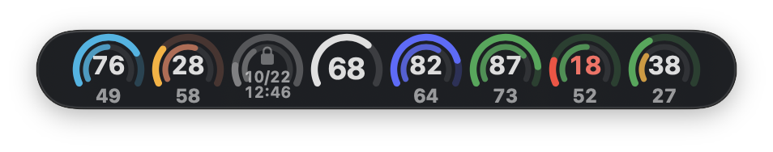
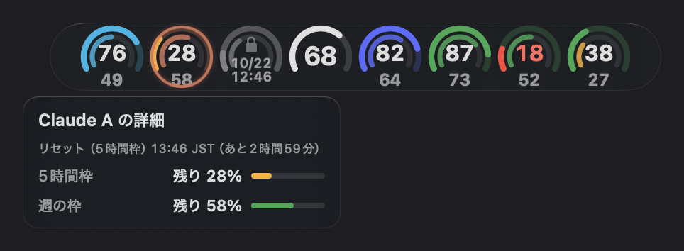
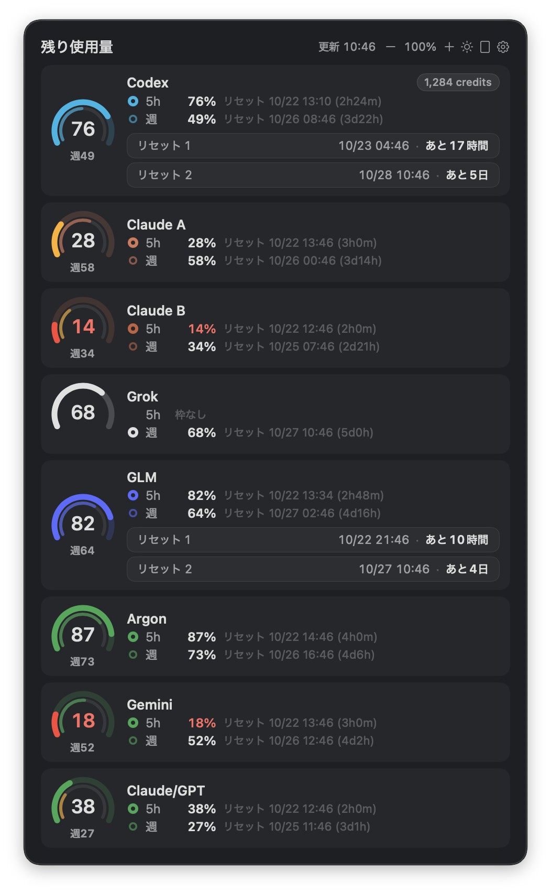
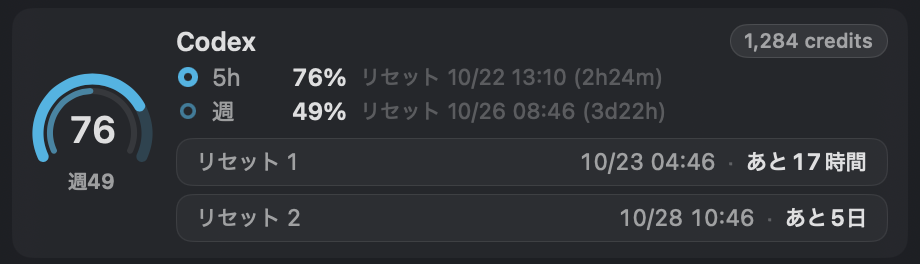

# UsageRings

See your AI usage limits and reset times at a glance in a compact, floating macOS ring dashboard.

[日本語](README.ja.md) · [Build and install](#build-and-install) · [Troubleshooting](#troubleshooting)



## What you can do

- Keep remaining quota visible in rings; hover for details or open the full panel.
- Compare 5-hour and weekly windows, reset countdowns, and weekly pace where the source supplies the data. Other reported windows, including monthly limits, are supported too.
- See reset tickets, balances, limit notices, and fetch errors alongside usage, where available.
- Choose horizontal or vertical layout, panel/bar zoom, light/dark appearance, opacity, and which providers and accounts to show.
- Label accounts and choose a **Primary** account for a provider's collapsed rings while keeping other visible accounts in the panel.

The dashboard refreshes about once a minute; individual readers have their own cache and backoff intervals. Unknown data is not unused quota. Retained readings are marked as previous/stale values. Some UI labels are Japanese.

## Supported providers

Values depend on your plan, login, and the installed reader's response; this table does not guarantee every window for every account.

<!-- provider-table:start -->
| Provider | What it shows | How it is read / setup |
| --- | --- | --- |
| Codex | Session/5-hour and weekly limits; reported credits and reset tickets | CodexBarCLI; configure Codex in CodexBar |
| Claude Code | Reported 5-hour and weekly limits per configured login; reset tickets and separate log-limit notices | CodexBarCLI with `--source cli`; signed-in Claude Code. Ticket sources are described below |
| Grok | Reported quota windows and details | CodexBarCLI with `--source cli`; configure the local Grok CLI login |
| GLM Coding Plan | Reported quota windows; Z.ai reset-ticket details | CodexBarCLI (`zai`); configure Z.ai in CodexBar. Tickets also use Z.ai's API |
| MiniMax | Reported quota windows and details | CodexBarCLI; configure MiniMax in CodexBar |
| Kimi | Reported quota windows and details | CodexBarCLI; configure Kimi in CodexBar |
| DeepSeek | Balance and usage details, without a quota-percentage ring | CodexBarCLI; configure DeepSeek in CodexBar |
| OpenDesign | Design Plan 5-hour and 7-day windows | Direct OpenDesign control API; sign in through the official app or `od amr login` |
| Antigravity | Reported model-group quota windows | CodexBarCLI with `--source cli`; configure the local Antigravity CLI login |
| Gemini | Gemini app 5-hour and weekly values when readable | Optional [Chrome automation](Sources/CodexUsageWidget/Services/GeminiAppUsage.swift) reading `gemini.google.com/usage`; off by default, separate from Antigravity |
<!-- provider-table:end -->

CodexBarCLI is required for all rows except OpenDesign and Gemini. UsageRings looks only at `/Applications/CodexBar.app/Contents/Helpers/CodexBarCLI`, with no `PATH` search or path setting. The CodexBar menu bar app need not stay running. UsageRings does not install provider CLIs or sign you into them. Claude, Grok, and Antigravity explicitly use the CLI source; other CodexBar providers use CodexBar's source selection.

Implementation references: [provider list](Sources/CodexUsageWidget/Models/MultiUsageSnapshot.swift), [fetch/source policy](Sources/CodexUsageWidget/Services/MultiUsageService.swift), [window parsing](Sources/CodexUsageWidget/Services/MultiProviderParser.swift).

## Build and install

Requires **macOS 14 or later** and **Swift 5.9 or later**. Select Xcode or its Command Line Tools with `xcode-select`; internet access is needed to resolve the pinned Sparkle dependency. See [Package.swift](Package.swift).

From a downloaded or cloned copy of this repository:

```sh
cd usagerings
swift build
swift test --filter READMEProviderTests
USAGERINGS_SIGN_IDENTITY=- ./script/build_and_run.sh usagerings package
./script/build_and_run.sh usagerings package-verify
```

If already in the source directory, skip `cd usagerings`. The [packaging script](script/build_and_run.sh) creates `dist/UsageRings.app`; `package-verify` checks its bundle. The explicit `-` selects local ad-hoc signing without a signing identity or developer account. These commands do not install, launch, notarize, or publish the app. Drag the resulting app into Applications and open it yourself. Rebuilds may cause macOS to request Keychain access again.

Keep the explicit `usagerings package` arguments: omitting the mode uses legacy `run` behavior, which stops the running app, replaces `~/Applications/UsageRings.app`, and launches it. The SwiftPM executable is still named `CodexUsageWidget`; raw `swift run` is not the multi-provider installation path.

## First run

1. Install [CodexBar](https://github.com/steipete/CodexBar) in `/Applications` and configure the services you use. At the missing-helper guide, choose **Check Again** after installation, or **Later** to continue.
2. Open the ring dashboard's panel and its **gear (Settings)**. Under **表示するサービス**, choose providers. Initially, successful usage readings turn providers on automatically; explicitly disabled providers are not fetched. Previously undecided providers are probed at most every 30 minutes.
3. Under **アカウント**, set labels, visibility, and **Primary** as needed. Account names are hidden by default; the name toggle shows masked names, while custom labels are shown as entered. Antigravity groups accounts by model by default; enable **Antigravityをアカウント別に表示** to split them.
4. For Gemini, start Chrome and sign in to Gemini yourself. Enable **Gemini の使用量を読む** from the app menu, allow macOS Automation access, and enable Chrome's **Allow JavaScript from Apple Events**. UsageRings can create and reload its own hidden usage window; it can also read an already open usage tab without reloading that tab. Turning reading off closes its own window. It does not sign in or handle verification pages for you.

### Claude accounts and reset tickets

Claude logins are detected from existing `~/.claude-a` and `~/.claude-b` directories, falling back to the default `~/.claude` login if neither exists. In **Settings → Claude accounts**, enter one `label = folder` per line to choose other config directories, or restore automatic detection. Each login is queried sequentially through CodexBarCLI with its own `CLAUDE_CONFIG_DIR`; values may appear after the background read completes.

The **Claudeの使う順番を自動で決める（claude-ab）** option defaults to on. When both A/B identities can be matched unambiguously, it writes a local, expiring hint for an existing `claude-ab` wrapper: prefer the earlier weekly reset, temporarily fall back when limited. It neither installs the wrapper nor switches running sessions. See the [account policy and hint format](docs/claude-account-switching.md).

Claude tickets combine read-only OAuth usage responses with the matching organization's [Claude Desktop usage cache](Sources/CodexUsageWidget/Services/ClaudeDesktopResetCache.swift). Open **Claude Desktop → Settings → Usage** to refresh that cache; cached tickets carry their observation time. OAuth ticket checks are at least 15 minutes apart per account and respect longer rate-limit delays. Unavailable or ineligible responses are not treated as zero tickets. GLM ticket detail uses the default CodexBar config's global-region Z.ai key; custom API hosts/config overrides and multiple token accounts are not supported by that detail reader. UsageRings displays tickets; it does not redeem them.

### Optional remote Claude notices

**Read remote Claude B limits over SSH** in Settings is off by default with no host configured. It reads limit-event notices from `~/.claude-b/projects` on a Linux host with Bash, GNU tools, and Python 3, at most once every five minutes. Set up SSH authentication and trusted host keys beforehand. Enter a hostname, SSH alias, or `user@hostname`; use an alias for custom ports/options. Changes apply on the next refresh. **Claude logs A/B** notices are separate from quota-account rings and Primary settings because log profiles do not establish quota-account identity.

## Privacy and security

UsageRings uses existing local logins and configuration; fetching current usage involves provider network traffic. It has no UsageRings-hosted account or analytics service.

| Local read | What leaves the Mac |
| --- | --- |
| CodexBarCLI and its configured provider logins | Provider requests made by CodexBarCLI; credential/source handling for those reads belongs to CodexBar |
| Z.ai key in `~/.config/codexbar/config.json` or `~/.codexbar/config.json` | Key authenticated requests to Z.ai's reset-ticket API |
| OpenDesign AMR `prod` control key, normally in `~/.amr/config.json` (supports `AMR_HOME`) | Key authenticated usage requests to `amr-api.open-design.ai` |
| Existing Claude Code OAuth login in Keychain | Token authenticated GET to the fixed Anthropic usage endpoint for ticket checks |
| Claude login organization ID and bounded matching entries in `~/Library/Application Support/Claude/Cache/Cache_Data` | Nothing from the Desktop cache reader; it reads cached usage responses without cookies or network requests |
| Recent bounded log tails in `~/.claude/projects`, `~/.claude-a/projects`, `~/.claude-b/projects`; profile email metadata for A/B matching | Local monitoring sends no logs; optional SSH connects to your chosen host and receives filtered limit text, timestamps, and model identifiers |
| Gemini usage-page text through Chrome automation, only when enabled | Chrome loads/reloads the usage page using its signed-in browser session; UsageRings does not extract browser cookies or passwords |

The direct [Claude ticket](Sources/CodexUsageWidget/Services/ClaudeResetGrants.swift), [Z.ai](Sources/CodexUsageWidget/Services/ZaiResetTickets.swift), and [OpenDesign](Sources/CodexUsageWidget/Services/OpenDesignUsage.swift) clients disable cookies and redirects. UsageRings reads existing credentials but does not store new credentials in Keychain.

Settings and cached Gemini readings stay in local UserDefaults. Account display preferences use salted provider-scoped hashes rather than raw account IDs/emails; custom labels and Claude config paths are local settings. Codex snapshots and redacted fetch-failure logs are written under `~/Library/Application Support/CodexUsageWidget-Multi/`. Private temporary snapshots and window diagnostics use a per-user `UsageRings` folder under `$TMPDIR` (directory 0700, snapshot files 0600). Unreadable Gemini pages can produce a redacted sample under `~/Library/Application Support/UsageRings/`. Treat diagnostics, custom labels, and screenshots as personal usage data before sharing.

The optional iPhone iCloud sync switch is off by default. Its sender can upload supported usage percentages, reset times, availability, timestamps, and random device/account IDs to the user's private CloudKit database, excluding credentials, names, logs, and balances. **The source packaging flow does not include the required iCloud entitlements/container setup**, so this is not a working sync installation guide. See the [sender and entitlement check](Sources/CodexUsageWidget/Services/CloudSnapshotSender.swift).

## Troubleshooting

| Symptom | What to check |
| --- | --- |
| Missing CodexBarCLI | Put CodexBar in `/Applications`, not a subfolder. Recheck the fixed helper path above; OpenDesign and Gemini have separate readers, but the startup guide still checks CodexBar |
| Provider absent | Enable it under **表示するサービス** after completing its login; an automatic probe may not run again immediately |
| Login error / no values | Verify the same provider in CodexBar or its CLI. For Claude, check **Claude accounts** paths and allow time for sequential background reads |
| Previous/stale value or missing reset | Inspect the fetch error and observation time. Refresh after resolving login/network issues; missing data does not mean a full allowance |
| Claude tickets unknown | Open the matching account's Desktop **Settings → Usage**; check the cache timestamp. API ineligibility or 429 can leave tickets unknown |
| Gemini unknown / stopped | Keep Chrome running; check Automation and JavaScript permissions. Resolve login/verification in Chrome yourself, then toggle reading off/on. Use **作り直す** if the dedicated window is missing. Reads are at least five minutes apart and pause while idle, asleep, or during local hours 01:00–05:59 |
| OpenDesign unavailable | Sign in through OpenDesign/AMR and check that the account has a personal workspace with an active Design Plan |
| SSH notice fails | Test your alias and trusted host key outside the app; verify the remote tools/log path. The panel deliberately omits host details from errors |
| Build fails | Check `swift --version` and `xcode-select -p`, and dependency-download access. Run `./script/lint.sh` for repository policy checks |

## More screenshots

These images use built-in demo data, not live account readings.

| Hover detail | Detail panel |
| --- | --- |
|  |  |



## Contributing and license

See [CONTRIBUTING.md](CONTRIBUTING.md) for development and checks, [SECURITY.md](SECURITY.md) for vulnerability reports, and the [Code of Conduct](CODE_OF_CONDUCT.md). If UsageRings is useful, a GitHub star helps others find it.

[MIT License](LICENSE), copyright AkiGarage. Third-party dependencies retain their own licenses.
