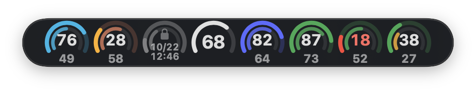
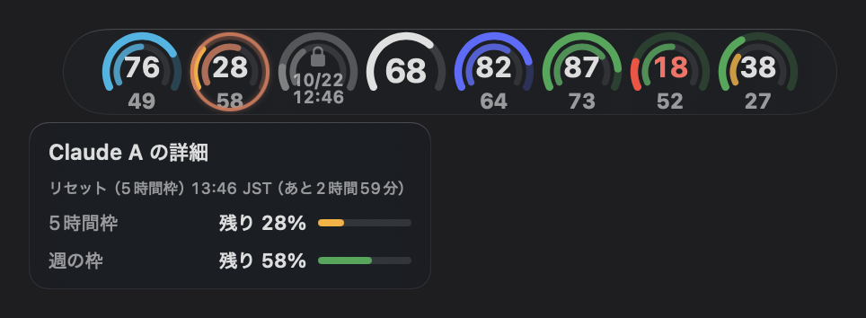
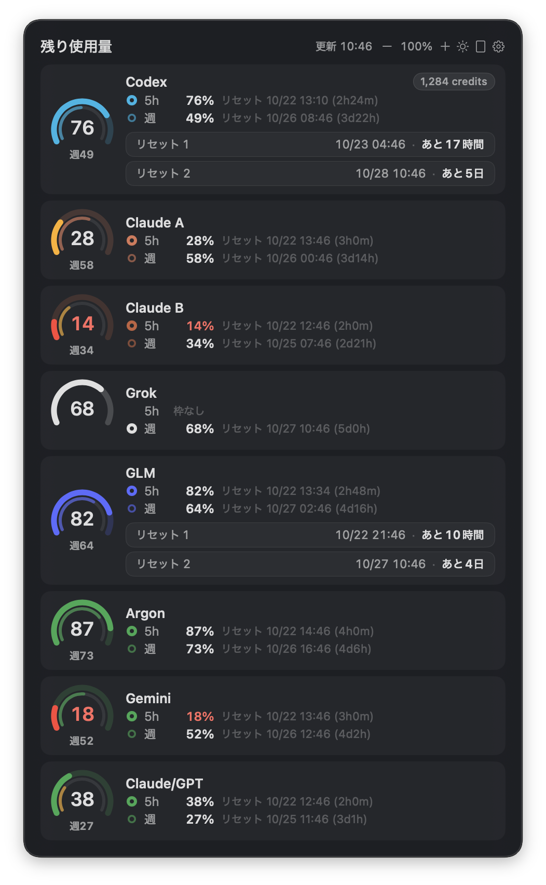
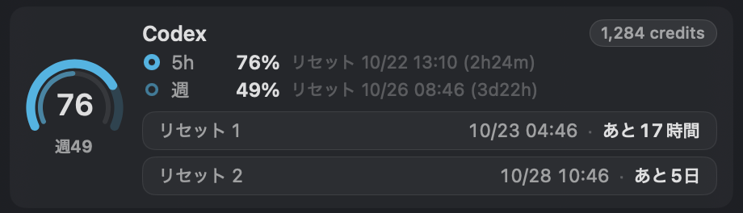

# UsageRings

A compact, floating macOS dashboard for AI usage limits. Keep remaining quota and reset times visible without relying on a menu bar item.

[日本語](README.ja.md)

## What it shows

- Remaining usage as colored rings, with session, weekly, or monthly windows when a provider reports them.
- A detail panel with reset times, account-separated limits, rate-limit notices, and provider errors.
- Horizontal or vertical layout, independent panel/bar zoom, light/dark appearance, and adjustable opacity.
- Local Claude Code rate-limit events. Account labels are hidden by default; optional labels are masked.

The dashboard refreshes about once a minute. Individual providers can cache results or back off after rate limits. Missing data is shown as unavailable; it is not a promise of unused quota. Some interface labels are currently Japanese.

## Providers and requirements

| Provider | Data source | Required setup |
| --- | --- | --- |
| OpenAI Codex | CodexBarCLI | CodexBar installed and its Codex provider configured |
| Claude Code | Local CLIProxyAPI; local Claude Code logs supplement limit notices | An enabled Claude account in CLIProxyAPI |
| Google Antigravity | Local CLIProxyAPI | An enabled Antigravity account with a project ID |
| Z.ai / GLM Coding Plan | CodexBarCLI; Z.ai reset-ticket API for optional detail | CodexBar's Z.ai provider configured |
| MiniMax / Kimi | CodexBarCLI | The corresponding provider configured in CodexBar |
| DeepSeek | CodexBarCLI | DeepSeek configured in CodexBar; balance and usage details without a quota percentage |
| Grok | Local CLIProxyAPI | An enabled Grok account |

Requires **macOS 14 or later**. Building requires Xcode Command Line Tools with **Swift 5.9 or later** and internet access to resolve the pinned Sparkle dependency. The command-line tools must be selected with `xcode-select`.

**CodexBarCLI is still required for the Codex, GLM, MiniMax, Kimi, and DeepSeek sections.** This version looks for it at `/Applications/CodexBar.app/Contents/Helpers/CodexBarCLI`; it does not search `PATH` or offer a CLI-path setting. The CodexBar menu bar app does not need to stay open. Other sections can work independently when that helper is missing.

For Claude, Antigravity, and Grok, UsageRings expects an existing CLIProxyAPI service at `http://127.0.0.1:8317/v8/management/` and its management key in a macOS Keychain generic-password item with the service name `cliproxyapi-management`. Configure these separately; UsageRings does not install the proxy or provide an account-sign-in screen. Missing setup is reported in the panel.

Optional GLM reset-ticket details use the default CodexBar configuration's global-region Z.ai API key. Custom config/API-host overrides and multiple token accounts are not supported by that detail reader.

Antigravity keeps accounts together within each model group by default. To split them, enable **Antigravityをアカウント別に表示** in the panel's **gear (Settings)** or the tab's **表示** menu. The panel, rings, and hover details update immediately; a single account keeps its existing display.

In **Settings → アカウント**, give each account a custom label, clear it, or hide/show the account. Custom labels appear in panel rows, ring tooltips, and detail cards independently of the masked account-name toggle. **Primary** limits that provider's collapsed rings to one account; the other visible accounts remain in the panel. The default is **すべて表示** (show all). A hidden or temporarily missing primary falls back to the first visible account, and hidden accounts remain editable in Settings. Preferences use provider-scoped SHA256 identifiers in local UserDefaults, never raw account IDs, emails, or credentials. If a source supplies multiple accounts without stable identifiers, their settings are unavailable until the source reports an identifier.

Claude log profiles do not report a quota-account ID. Their **Claude logs A/B** limit notices remain separate from account rings, labels, visibility, and Primary selection, so response ordering cannot attach a log warning to the wrong account.

## Build and install

From the downloaded or cloned source directory:

```sh
swift build
swift test
./script/build_and_run.sh usagerings package
./script/build_and_run.sh usagerings package-verify
```

The package command creates `dist/UsageRings.app` without launching or installing it. Drag that app to your Applications folder, then open it. The source target remains named `CodexUsageWidget` for compatibility; launching the raw `swift run` executable is not the multi-provider app installation path.

Include the explicit `package` mode when building. Omitting the mode selects the legacy `run` behavior, which stops any running UsageRings app, replaces `~/Applications/UsageRings.app`, and launches it.

Local packages use ad-hoc signing by default. To use your own signing identity:

```sh
USAGERINGS_SIGN_IDENTITY='Your signing identity' ./script/build_and_run.sh usagerings package
```

This build command does not notarize or publish an app. Ad-hoc rebuilds can cause macOS to ask again for Keychain access.

## Optional remote Claude limits

Open the detail panel and click the **gear (Settings)**. Enable **Read remote Claude B limits over SSH**, then enter a hostname, SSH alias, or `user@hostname`. The default is **off**, with no host configured. The settings are stored locally under `claudeRateLimitSSHEnabled` and `claudeRateLimitSSHHost` in UserDefaults.

This optional reader supports a Linux host with Bash, GNU command-line tools, Python 3, and Claude B logs under `~/.claude-b/projects`. Set up SSH authentication and trust the host key yourself first. UsageRings uses noninteractive SSH, requires an already trusted host key, and polls at most once every five minutes. Host options, URLs, and port suffixes are not accepted; use an SSH alias for custom connection settings. Changes apply on the next refresh.

## Privacy

UsageRings stores its settings and display snapshots **locally only**. It has no UsageRings-hosted account, analytics service, or cloud upload. It does not expose an HTTP/LAN server.

Fetching current usage still requires network access: CodexBarCLI communicates with its providers, the local authenticated proxy brokers provider requests, and GLM reset-ticket details contact Z.ai directly. Enabling remote Claude monitoring adds SSH traffic to the host you configure. “Local-only” describes storage and processing, not offline operation.

Local Claude monitoring reads bounded recent log tails from `~/.claude/projects`, `~/.claude-a/projects`, and `~/.claude-b/projects`. Remote monitoring returns filtered quota-event text, timestamps, and model identifiers. Local Codex display snapshots are written to `~/Library/Application Support/CodexUsageWidget-Multi/` and a per-user `UsageRings` folder inside the macOS per-user temporary directory (`$TMPDIR`, mode 0700; files 0600), which also holds a provider/window diagnostic JSON file. This version writes nothing to the shared `/private/tmp`; files left there by older builds are not removed automatically. If remote Claude monitoring over SSH fails, the separate "Claude logs B" notice shows a short reason without host details. Treat these files as personal usage information and sanitize logs or screenshots before sharing them.

## A lighter app bundle

The maintainer's reference app-bundle comparison is **CodexBar: 163 MB** versus **UsageRings: 7.3 MB**. These are on-disk bundle sizes from a particular build, not RAM measurements or a guarantee for every build. The UsageRings figure excludes the still-required CodexBarCLI installation and optional CLIProxyAPI service. UsageRings focuses on the floating display and does not replace CodexBar's broader account-management features.

## Screenshots

All screenshots use built-in demo data (dark appearance, bar zoom 200%).

| Collapsed bar | Hover detail |
| --- | --- |
|  |  |



Reset tickets are listed one per line with their expiry and time left:



## Contributing and license

See [CONTRIBUTING.md](CONTRIBUTING.md), [SECURITY.md](SECURITY.md), and the [Code of Conduct](CODE_OF_CONDUCT.md). Licensed under the [MIT License](LICENSE), copyright AkiGarage. Third-party dependencies retain their own licenses.
