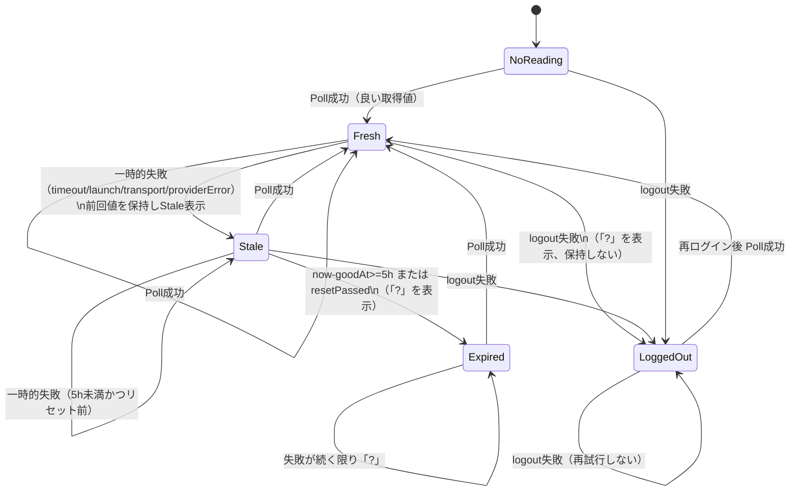

# 取得キャッシュの状態モデル（fetch-cache）

2026-11-05 の "?" リング不具合（1回の取得失敗で前回値が消える）の修正に対する状態モデル。
対象は `MultiUsageService` / `ClaudeCLIUsage` → `MultiUsageStore.retainingStaleValues` の流れ。

## 日本語でのルール（不変条件の元になる文）

1. リングに「?」を出してよいのは、(a) 直近5時間に良い取得値がない、(b) リセット時刻を過ぎている、(c) ログアウトしている、のいずれかの場合だけ。
2. 一時的な失敗（タイムアウト、起動失敗、通信エラー、プロバイダエラー・HTTP 5xx/429、パース失敗）では前回の良い値を「Stale」表示で保持し、5時間またはリセット期限まで示し続ける。
3. ログアウト（CLI が not logged in / unauthorized / 401 / no credentials / login required / please log in / not authenticated を明示）では前回値を保持せず「?」とする。ログアウトは一時失敗として再試行しない。
4. 逆に、ログアウト中か、値の期限（5時間またはリセット）が切れているのに数値を示してはならない。
5. 一時的な失敗は1回だけ（約2.5秒後に）再試行する。部分結果として使える出力（複数アカウントの一部のみ失敗）は再試行しない。
6. 失敗の診断のため、1失敗につき1行（時刻・プロバイダ・理由・終了コード・マスク済みメッセージ）を `fetch-failures.log` に追記する。秘密は決して書かない。

## 状態遷移図

## TLA+ 仕様

`FetchCache.tla`（設定 `FetchCache.cfg`）が上のモデルを形式化し、次を不変条件として検証する。

- `InvQuestionOnlyWhenJustified`: `shown = "?" => (goodAt = -1 \/ now - goodAt >= 5 \/ now >= reset \/ loggedOut)`
- `InvNeverShowValueWhenGone`: `shown = "value" => (goodAt # -1 /\ now - goodAt < 5 /\ now < reset /\ ~loggedOut)`

`FetchCacheFault.cfg` は「ログアウトしても前回値を保持する」故障注入（`RetainOnLogout = TRUE`）で、
不変条件がその故障を検出することを確認するために使う。

TLC はこの環境に入っていないため、同等の全状態探索を `docs/fetch_cache_check.py`（Python, 標準ライブラリのみ）で行う。
実行: `python3 -B docs/fetch_cache_check.py`（正常系は OK、故障系は violation を報告して終了コード1）。

## プロバイダー別の自動取得予算

`ProviderRefreshBudget` は `MultiUsageStore` の取得開始前に置く admission policy。
Antigravity は既定900秒間隔、失敗時は2倍・4倍・最大8倍に延ばし、成功で戻す。
セクション全体の失敗だけでなく、部分アカウント失敗も待機を延ばす。
明示的な手動更新と `ResetRefreshPlanner` の対象別更新は予算を迂回する。
リセット再試行は既存の回数・間隔制限を保つ。取得内の1回の再試行も維持する。
非表示のプロバイダーは迂回時にも取得しない。他プロバイダーの既定動作と、
別経路の `GeminiAppUsageMonitor`（既存タブのみの観測）は変更しない。

予算によるスキップは Poll成功でも一時的失敗でもなく、取得状態に対する stuttering
（同じ状態の保持）である。観測時刻・失敗理由・Stale・ログアウト状態を更新しない。
経過時間による `Tick` は継続し、保持中の正常値にもリセット時刻と5時間の期限を適用する。
失敗が発生した場合は従来どおり `retainingStaleValues` を通し、ログアウト値は保持しない。
`FetchCache.tla` の `[][Next]` はこの stuttering を既に許容するため、取得キャッシュの
状態・不変条件の変更はない。予算の間隔・手動/リセット迂回・エラーバックオフは
`ProviderRefreshBudgetTests` の注入時計と実際のストア取得経路で検証する。

取得開始と部分マージは追加で `formal/UsageRefresh.tla` と
`formal/ProviderBudget.tla` に形式化した。対応表・故障注入・状態図・同期検査は
[refresh-statechart.md](formal/refresh-statechart.md) を参照する。
