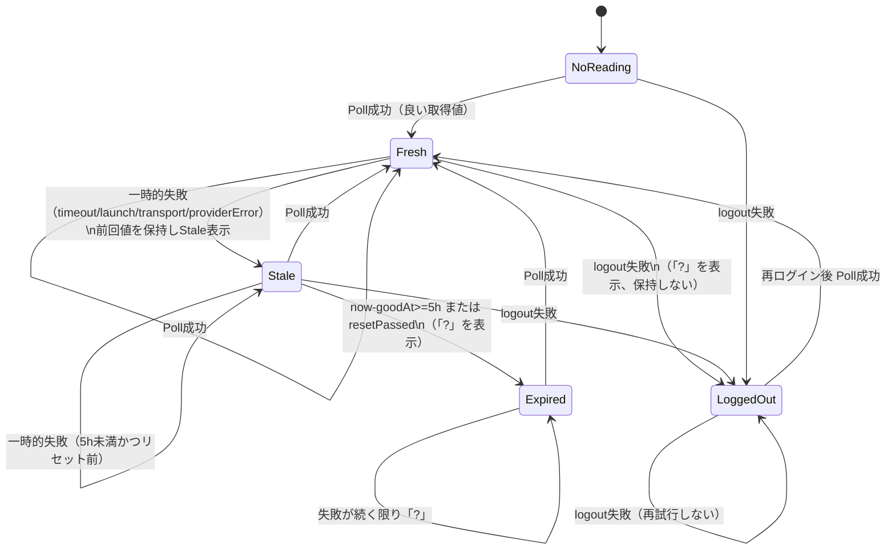
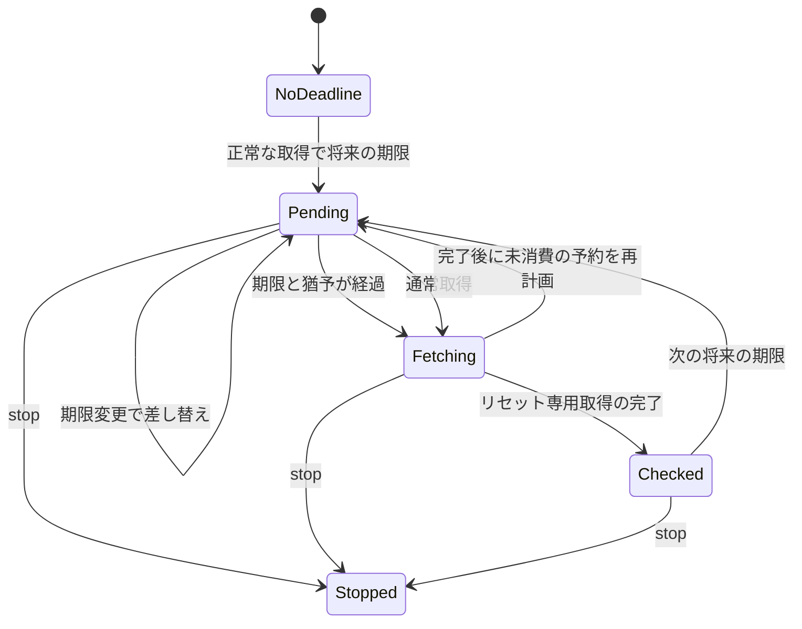

# 取得キャッシュの状態モデル（fetch-cache）

2026-11-05 の "?" リング不具合（1回の取得失敗で前回値が消える）の修正に対する状態モデル。
対象は `MultiUsageService` / `ClaudeCLIUsage` → `MultiUsageStore.retainingStaleValues` の流れ。

## 日本語でのルール（不変条件の元になる文）

1. リングに「?」を出してよいのは、(a) 直近5時間に良い取得値がない、(b) リセット時刻を過ぎている、(c) ログアウトしている、のいずれかの場合だけ。
2. 一時的な失敗（タイムアウト、起動失敗、通信エラー、プロバイダエラー・HTTP 5xx/429、パース失敗）では前回の良い値を「Stale」表示で保持し、5時間またはリセット期限まで示し続ける。
3. ログアウト（CLI が not logged in / unauthorized / 401 / no credentials / login required / please log in / not authenticated を明示）では前回値を保持せず「?」とする。ログアウトは一時失敗として再試行しない。
4. 逆に、ログアウト中か、値の期限（5時間またはリセット）が切れているのに数値を示してはならない。
5. 一時的な失敗は1回だけ（約2.5秒後に）再試行する。部分結果として使える出力（複数アカウントの一部のみ失敗）は再試行しない。
6. 失敗の診断のため、1失敗につき1行（時刻・プロバイダ・理由・終了コード・マスク済みメッセージ）を `fetch-failures.log` に追記する。秘密は決して書かない。

## 状態遷移図

## TLA+ 仕様

`FetchCache.tla`（設定 `FetchCache.cfg`）が上のモデルを形式化し、次を不変条件として検証する。

- `InvQuestionOnlyWhenJustified`: `shown = "?" => (goodAt = -1 \/ now - goodAt >= 5 \/ now >= reset \/ loggedOut)`
- `InvNeverShowValueWhenGone`: `shown = "value" => (goodAt # -1 /\ now - goodAt < 5 /\ now < reset /\ ~loggedOut)`

`FetchCacheFault.cfg` は「ログアウトしても前回値を保持する」故障注入（`RetainOnLogout = TRUE`）で、
不変条件がその故障を検出することを確認するために使う。

TLC はこの環境に入っていないため、同等の全状態探索を `docs/fetch_cache_check.py`（Python, 標準ライブラリのみ）で行う。
実行: `python3 -B docs/fetch_cache_check.py`（正常系は OK、故障系は violation を報告して終了コード1）。

## リセット時刻の専用取得

`MultiUsageStore` は、正常な最新の取得結果に将来のリセット時刻がある場合、
その20秒後に対象プロバイダーだけを1回取得する。タイマーの許容幅は0.5秒。
通常の60秒ポーリングやサービス内の一時失敗再試行は変えない。
リセット専用の2回目・3回目の確認は行わない。既に過ぎた未知の期限からは予約しない。
既知の予約はスリープ復帰時に追いつき、取得中なら完了後に再計画する。
正常な取得が次の期間を示していれば旧予約は取り消す。

1本の共有タイマーが全アカウント・使用枠の最も早い期限を待つため、
各プロバイダー／アカウントの保留タイマーも最大1本となる。
同時に期限を迎えた枠は1回のプロバイダー取得にまとめる。
`resetTimerGeneration` で差し替え済み・停止済みのコールバックを無効化し、
`isRefreshing` で通常取得との重複を防ぐ。停止前の応答の適用を防ぐ既存の世代管理、
および `FetchCache.tla` の表示・保持ルールは変更しない。

日本語の不変条件と対応コードは `formal/reset-refresh/ResetRefresh.tla` と
`.cursor/skills/usagerings-formal-verification/SKILL.md` に記載。
TLC 1.7.4配布jar（出力では TLC2 2.19）で218状態・779遷移を検査し、5条件すべて成立。
5つの `Fault-*.cfg` がそれぞれ対応する違反を検出した。

モデルは1サービス・2期限・猶予経過を表す抽象時計を扱う。
実秒数、複数アカウントの解析、CLI内のキャッシュ・再試行、OSによる配送遅延は
Swiftテストまたはサービスの既存検査の対象であり、このモデルの保証外。
生成された全体図では、状態ラベル内に留まる遷移と時刻進行を省略する。
